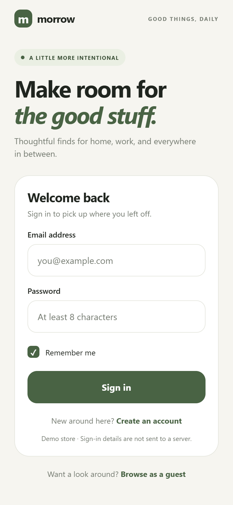
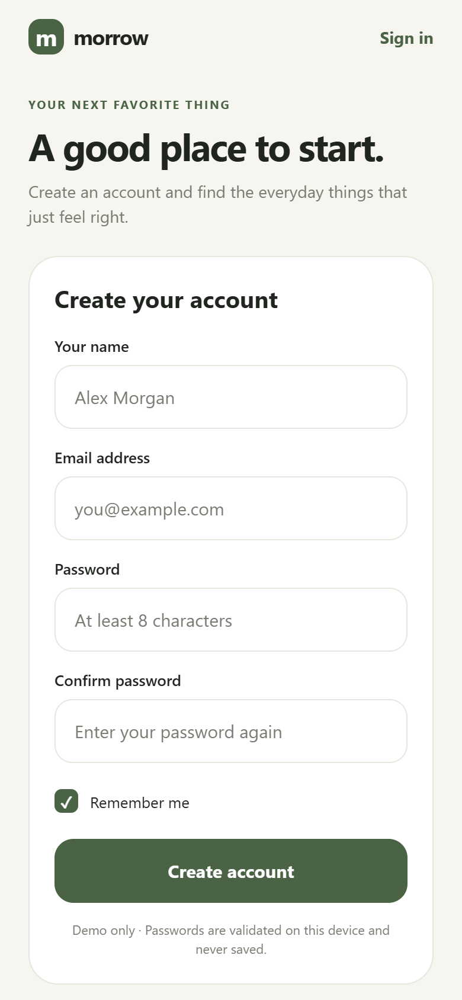
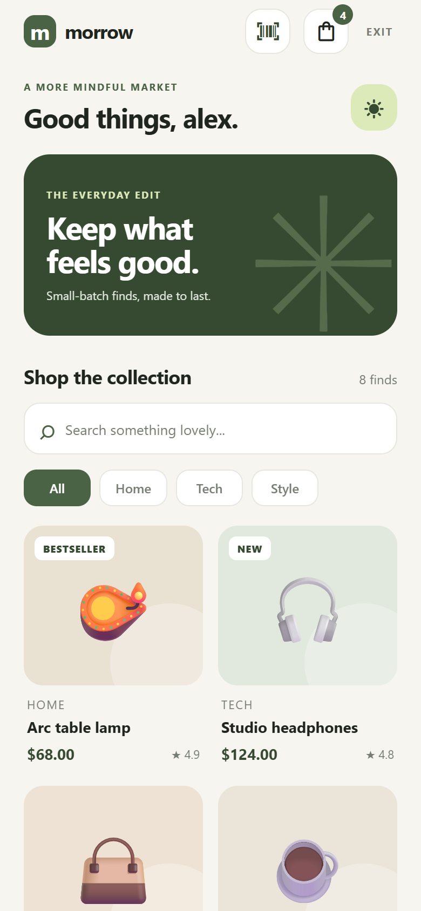
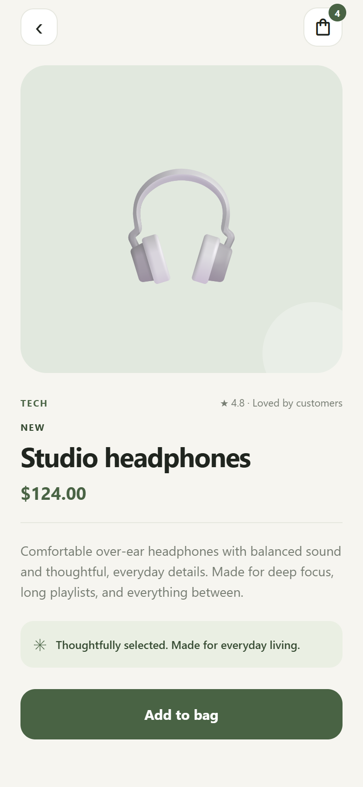
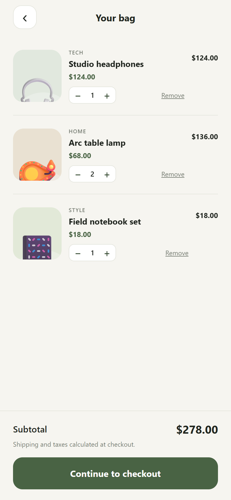
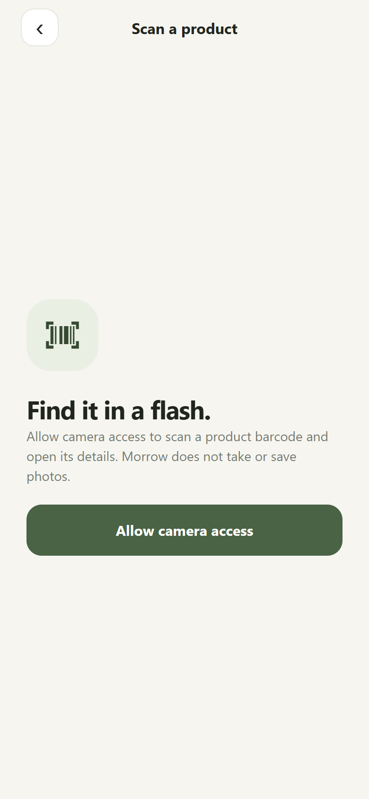

# Morrow

A small Expo Router storefront demo with a curated product catalog, product details, barcode scanning, biometric sign-in, and a persistent shopping bag.

## Screens

| Sign in | Create account | Catalog |
| :---: | :---: | :---: |
|  |  |  |
| Email and password sign-in with a remember-me option. Remembered profiles can continue with fingerprint or Face ID. | Name, email, password, and confirmation fields, all validated before the account is created. | Personal greeting, search, category filters (Home, Tech, Style), and a bag badge with the item count. |

| Product details | Shopping bag | Barcode scanner |
| :---: | :---: | :---: |
|  |  |  |
| Category, label, rating, price, and description, with an add-to-bag button. | Quantity steppers, per-line totals, remove buttons, and a running subtotal. | Asks for camera access, then opens the matching product page when a barcode is scanned. |

## Features

- **Forms:** sign-in and registration forms use React Hook Form with Yup validation (valid email, password of at least 8 characters, matching confirmation).
- **Remember me:** saves only the demo profile (name and email) on the device. Passwords are never stored.
- **Biometric sign-in:** remembered users can sign in with fingerprint on supported devices, or Face ID where available. It uses `expo-local-authentication` and is not available on web.
- **Catalog:** an 8-item sample catalog with text search, category filters, and a detail page for each product.
- **Barcode scanning:** uses `expo-camera`. Supports EAN-13, EAN-8, UPC-A, UPC-E, and QR codes, and goes straight to the matching product.
- **Persistent bag:** items and quantities are saved with AsyncStorage, so they're still there after the app restarts.
- **Guest browsing:** you can open the catalog without signing in.
- **Demo checkout:** the checkout button doesn't collect payment.

## Tech stack

| Area | Library |
| --- | --- |
| Framework | Expo SDK 58, React Native 0.88, React 19.3 |
| Navigation | Expo Router (file-based routes in `src/app/`) |
| Forms | React Hook Form, Yup, `@hookform/resolvers` |
| Storage | `@react-native-async-storage/async-storage` |
| Device features | `expo-camera` (barcode scanning), `expo-local-authentication` (biometrics) |
| Icons | `expo-symbols` (SF Symbols on iOS, Material Symbols on Android and web) |
| Tooling | TypeScript, ESLint (`eslint-config-expo`) |

## Run locally

```bash
npm install
npx expo start
```

Use the Expo CLI prompts to open the app on a device, emulator, or web browser.

The camera and biometric modules contain native code. To try barcode scanning and biometric sign-in on a phone, build a development build instead of using Expo Go:

```bash
npx expo run:android   # or: npx expo run:ios
```

### Useful scripts

```bash
npm run lint           # ESLint
npx tsc --noEmit       # type check
npm run web            # start directly in the browser
```

## Demo barcodes

Every product has a demo EAN-13 barcode. Generate any of these codes with a barcode generator and scan it from the **Scan** button on the catalog screen.

| Product | Category | Price | Barcode |
| --- | --- | ---: | --- |
| Arc table lamp | Home | $68 | `2000000000015` |
| Studio headphones | Tech | $124 | `2000000000022` |
| Daily canvas tote | Style | $32 | `2000000000039` |
| Pour-over set | Home | $46 | `2000000000046` |
| Weekender bottle | Style | $28 | `2000000000053` |
| Pocket speaker | Tech | $84 | `2000000000060` |
| Soft cotton throw | Home | $58 | `2000000000077` |
| Field notebook set | Style | $18 | `2000000000084` |

## Project structure

```
src/
├── app/                  # Expo Router screens
│   ├── _layout.tsx       # Root stack, safe area, and shop provider
│   ├── index.tsx         # Sign in (password or biometrics)
│   ├── register.tsx      # Create account
│   ├── products.tsx      # Catalog with search and filters
│   ├── product/[id].tsx  # Product details
│   ├── cart.tsx          # Shopping bag and checkout
│   └── scan.tsx          # Barcode scanner
├── components/           # Shared UI (buttons, icons, text fields, product cards)
├── constants/theme.ts    # Color palette
├── context/              # Shop context: user, cart, and AsyncStorage persistence
└── data/products.ts      # Sample product catalog
```

## A note on authentication

Authentication is demo-only on purpose: any email and password that pass validation can sign in, and no account data is sent to a server. Replace the local demo flow with a real authentication service before using this app with real accounts.

Screenshots were captured from the web build at phone size (390 × 844).
